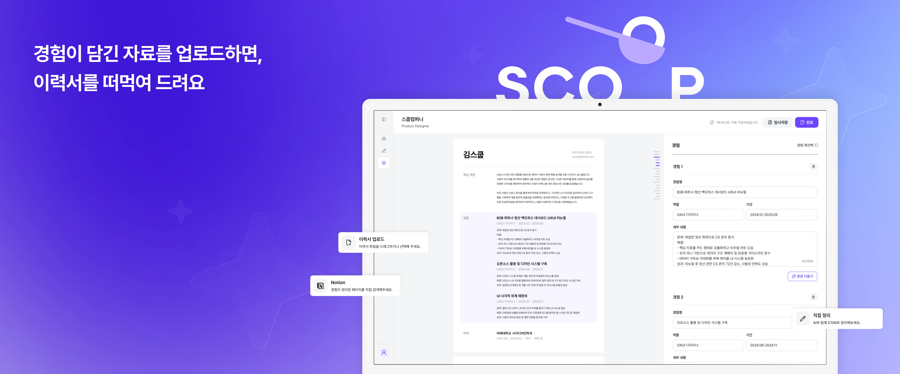
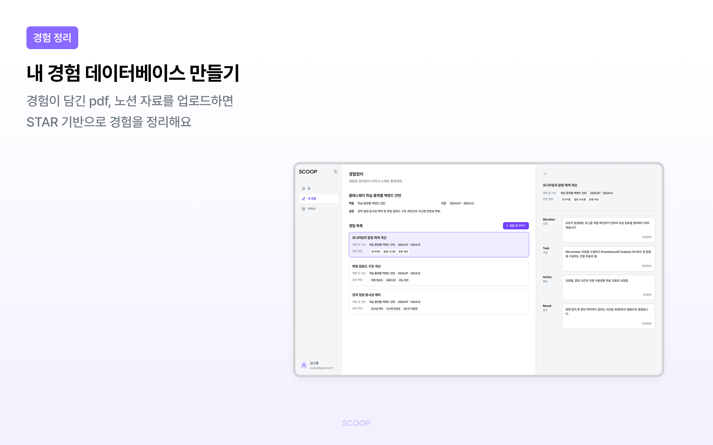
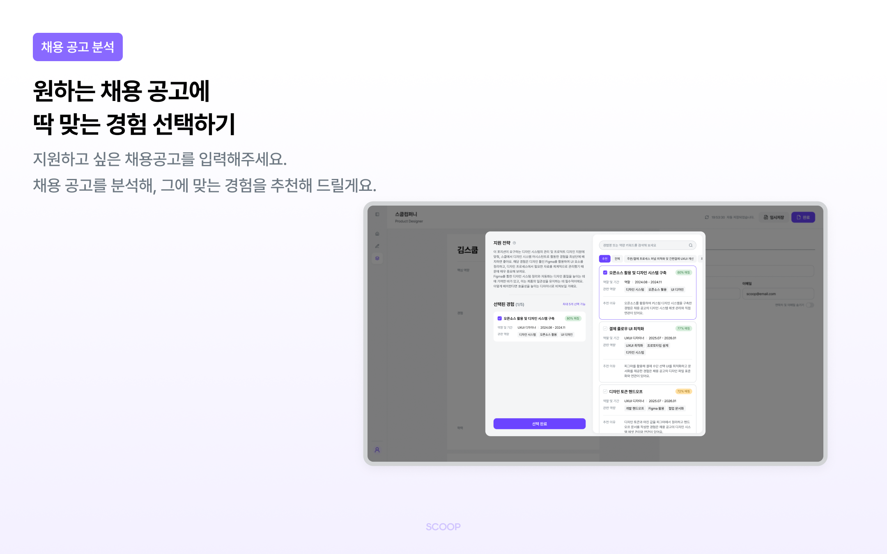
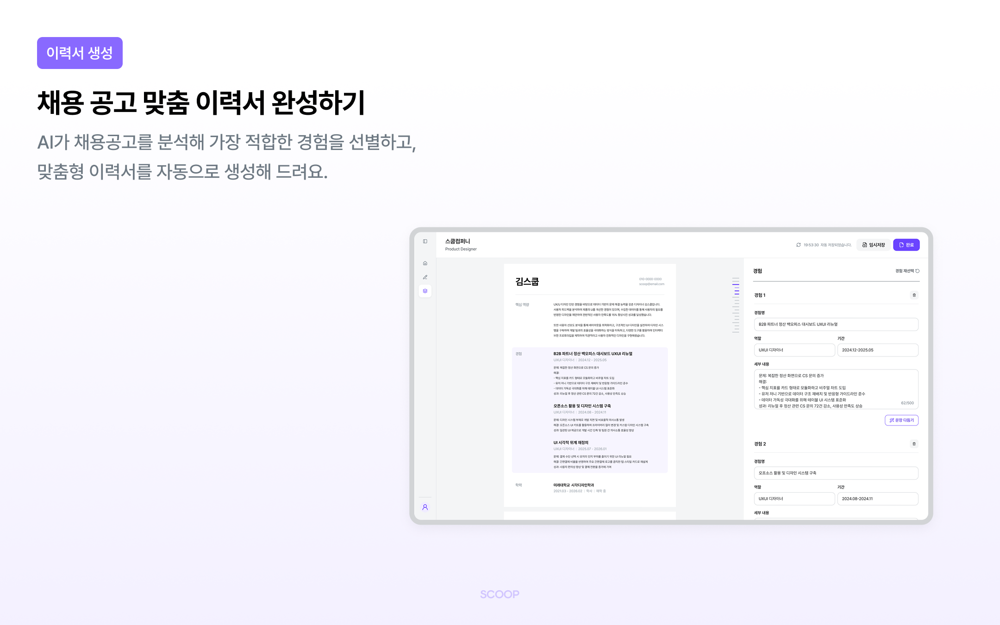

<br>

# 

> "SCOOP, 떠먹여 주는 이력서"

### 경험 정리부터 공고 맞춤 이력서까지, 5분 만에!

#### 내 경험 데이터베이스 만들기

Notion, PDF 등 경험이 담긴 자료를 업로드하거나 떠오르는 경험을 자유롭게 적어주세요. AI가 이력서에 적합한 **STAR(상황·과업·행동·결과)** 구조로 정리해 드려요.

#### 채용 공고 분석

지원하고 싶은 공고의 링크나 원문을 붙여넣으세요. 공고를 분석해 지원 전략과 함께 가장 잘 맞는 경험을 매칭률과 추천 이유로 보여드려요.

#### 공고 맞춤 이력서 자동 생성

AI가 선별한 경험으로 맞춤형 이력서를 자동으로 완성해요. 문장 다듬기로 다듬고, PDF로 바로 내려받을 수 있어요.





<br>

## Tech Stack

| 분류         | 기술                                               |
| ------------ | -------------------------------------------------- |
| Language     | TypeScript 5                                       |
| Framework    | Next.js 16 (App Router), React 19                  |
| Server State | TanStack Query v5                                  |
| API          | GraphQL (graphql-codegen), REST                    |
| Style        | Tailwind CSS v4, Radix UI Themes, shadcn/ui        |
| Form         | react-hook-form                                    |
| Animation    | motion                                             |
| Test / Docs  | Vitest, Storybook, Playwright (브라우저 모드), MSW |
| Monitoring   | Sentry, Amplitude                                  |
| Code Style   | ESLint, Prettier                                   |
| Git Hooks    | lefthook                                           |
| Deploy       | Vercel                                             |

<br>

## 아키텍처

**Feature-Sliced Design (FSD)** 을 따릅니다. 레이어 → 슬라이스 → 세그먼트 3단계 구조이며, 상세 규칙은 [`docs/architecture.mdx`](docs/architecture.mdx)를 참고하세요.

```
app → views(pages) → widgets → features → entities → shared
```

- 의존성은 항상 위에서 아래로만 흐릅니다. 같은 레이어 간 import, 역방향 import는 금지합니다.
- 슬라이스 외부에서는 반드시 `index.ts`(Public API)를 통해서만 import 합니다.

```
app/                 Next.js 라우팅 전용 (로직 없이 views를 re-export)
src/
├── app/             providers, styles, layouts
├── views/           페이지 단위 화면 (FSD pages 레이어)
├── widgets/         페이지를 구성하는 큰 블록 (sidebar, resume_preview)
├── features/        사용자 행동 단위 (authenticate, notion_connect, pdf_upload ...)
├── entities/        비즈니스 도메인 (user, experience, jd, resume ...)
└── shared/          도메인 무관 공통 코드 (ui, lib, hooks, config)
```

### 상태 관리

- **서버 데이터는 항상 TanStack Query** 로 관리합니다. 쿼리키·queryOptions는 `entities/*/model`에 둡니다.

### API 통신

모든 요청은 BFF 프록시(`app/api/[...path]/route.ts`)를 거치며, 인증 토큰은 httpOnly 쿠키로 처리합니다. GraphQL 작성 규칙은 [`docs/graphql_guide.mdx`](docs/graphql_guide.mdx)를 참고하세요.

<br>

## 로컬 개발 환경 설정

**사전 준비**: Node.js 24, npm

### 1. 의존성 설치

```bash
npm install
```

### 2. 환경변수

루트에 `.env`를 만들어 주세요. 필요한 값은 팀 노션을 참고하세요.

```
API_URL=
NEXT_PUBLIC_SITE_URL=
NEXT_PUBLIC_GOOGLE_CLIENT_ID=
NEXT_PUBLIC_NOTION_CLIENT_ID=
NEXT_PUBLIC_SENTRY_DSN=
NEXT_PUBLIC_AMPLITUDE_API_KEY=
```

### 3. 실행

```bash
npm run dev              # 개발 서버 (predev에서 GraphQL codegen 1회 자동 실행)
npm run build            # 프로덕션 빌드
npm run storybook        # Storybook (:6006)
```

### 4. 코드 생성 및 검사

```bash
npm run codegen          # GraphQL 타입 재생성 (쿼리 수정 시)
npm run codegen:watch    # 저장할 때마다 자동 재생성
npm run schema:pull      # 원격 스키마 → schema.graphql 갱신 (백엔드 스키마 변경 시)
npm run lint             # ESLint
npm run type-check       # tsc --noEmit
```

- `src/shared/lib/gql/`는 codegen 자동 생성물, `schema.graphql`은 스키마 스냅샷이므로 직접 수정하지 않습니다.
- pre-commit 훅이 staged 파일에 `eslint --fix`를, pre-push 훅이 타입체크를 실행합니다.

<br>

## 브랜치 전략

```
main            프로덕션 배포
dev             개발 통합 브랜치
feat/#이슈번호   기능 개발
bug/#이슈번호    버그 수정
chore/#이슈번호  설정, 빌드 등 기타 작업
docs/#이슈번호   문서 작업
```

작업은 이슈 번호 브랜치에서 진행하고 `dev`로 PR을 올립니다.

<br>

## 커밋 컨벤션

lefthook `commit-msg` 훅이 형식을 검사합니다.

```
{icon}[{Type}] {message} (#{이슈번호})
```

```
✨ Feat      새로운 기능
🐛 Fix       버그 수정
📝 Docs      문서 수정
💄 Style     UI, 스타일 변경
♻️ Refactor  리팩토링 (기능 변경 없음)
✅ Test      테스트 코드
⚙️ Chore     빌드, 설정, 의존성 등 기타 작업
```

예시: `✨[Feat] 로그인 기능 추가 (#123)`

브랜치명에 이슈 번호가 있으면 `prepare-commit-msg` 훅이 커밋 메시지 끝에 자동으로 붙여줍니다.

<br>

## 코드 컨벤션

- **폴더/파일**: 폴더는 `snake_case`, 컴포넌트는 `PascalCase`
- **라우팅**: `app/**/page.tsx`는 views를 re-export만 하고 로직을 두지 않습니다
- **레이아웃**: `@radix-ui/themes`의 `Flex`를 우선 사용하고, Radix prop이 없거나 포탈 내부면 Tailwind를 씁니다
- **반응형**: 브레이크포인트는 Radix 기준으로 통일되어 있습니다 (`sm` 768px, `md` 1024px — Tailwind 기본값과 다름)
- **Storybook**: 재사용 컴포넌트는 같은 위치에 `*.stories.tsx`를 함께 작성합니다 ([`docs/storybook_guide.mdx`](docs/storybook_guide.mdx))
- **컬러**: [`docs/color-palette.mdx`](docs/color-palette.mdx)

<br>

## 문서

| 문서                                                   | 내용                |
| ------------------------------------------------------ | ------------------- |
| [`docs/architecture.mdx`](docs/architecture.mdx)       | FSD 상세 규칙       |
| [`docs/graphql_guide.mdx`](docs/graphql_guide.mdx)     | GraphQL 작성 가이드 |
| [`docs/storybook_guide.mdx`](docs/storybook_guide.mdx) | Storybook 컨벤션    |
| [`docs/color-palette.mdx`](docs/color-palette.mdx)     | 컬러 시스템         |
